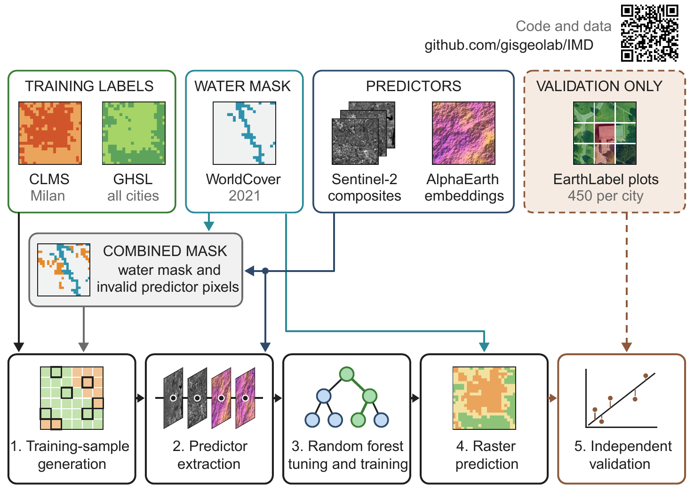

# Mapping Imperviousness Density Using Geospatial Foundation-Model AlphaEarth Embeddings

**Can AlphaEarth replace locally composed Sentinel-2 for 10 m imperviousness
mapping, and does it transfer across cities?**

Maria Antonia Brovelli, Matej Žgela, Keerthana Kirubakaran, Xiao Tan
· Politecnico di Milano

Impervious surface density (IMD) is the proportion of a pixel covered by
impervious material such as buildings, roads and pavement. This repository maps
it at 10 m for Milan, Hanoi and Ho Chi Minh City (HCMC) in 2018.

Hanoi and HCMC have no IMD product at all. The maps are needed to support local
climate zone mapping and urban heat island analysis in the **LCZ-UHI-GEO** and
**Space it up!** projects.



Every map comes from the same five steps: (1) training-sample generation,
(2) predictor extraction, (3) random forest tuning and training, (4) raster
prediction and (5) independent validation. CLMS and GHSL provide the training
labels, Sentinel-2 and AlphaEarth the predictors, and ESA WorldCover the water
mask. The EarthLabel plots are used only in step 5 and never for training or
tuning.

## Contributions

1. **Compare Sentinel-2 and AlphaEarth** for local 10 m imperviousness mapping.
2. **Evaluate both local training and direct cross-city transfer** across
   Milan, Hanoi and HCMC.
3. **Assess how the choice of training label** affects mapping accuracy.

### Predictors

AlphaEarth is one annual product: a single image per year, ready to use.
Sentinel-2 is not. It passes over each city many times a year, so 2018 gives
dozens of images, each with its own clouds and gaps. To get one set of model
inputs out of them, each date is screened for cloud and valid pixels over the
area of interest, and the remaining dates are combined in three ways. Those
three, plus AlphaEarth, are the four predictor sets. They are compared on Milan
with everything else kept the same, so the input is the only thing that
changes:

| Predictor | What it is |
|---|---|
| AlphaEarth embeddings | 64 bands from [Google Satellite Embedding V1](https://developers.google.com/earth-engine/datasets/catalog/GOOGLE_SATELLITE_EMBEDDING_V1_ANNUAL), summarising a year of Sentinel-2, Sentinel-1, Landsat and other observations per 10 m pixel |
| S2 median | per-pixel median of the clear 2018 dates, 10 bands |
| S2 percentile | 10th, 25th, 50th, 75th and 90th percentiles of each band, 50 bands (Milan only) |
| S2 Stack | a few clear dates kept as separate bands, 10 per date: four in Milan, three in Hanoi, one in HCMC |

Hanoi and HCMC have too few clear dates for a percentile composite, so they use
AlphaEarth, the S2 median and the S2 Stack. The dates are listed under
[Sentinel-2 dates](SUPPLEMENTARY.md#sentinel-2-dates).

### Training label

Milan is modelled against CLMS and against GHS-BUILT-S (GHSL). The two products
measure different things: CLMS maps sealed surface including roads, GHSL maps
roofed built-up area without them. Two sets of 3,500 points are drawn in Milan,
one stratified on CLMS and one on GHSL, and they give three training
configurations:

| Configuration | Training points | Training label | Used for |
|---|---|---|---|
| (a) | CLMS-stratified | CLMS | comparing the predictors |
| (b) | CLMS-stratified | GHSL, read at the same points | comparing the training labels: (a) and (b) differ in the label alone |
| (c) | GHSL-stratified | GHSL | the sampling strategy, (b) against (c), and the source of the GHSL transfer |

Comparing (a) and (b) separates what the method achieves from what the
training label already decides. Hanoi and HCMC lie outside CLMS coverage, so
their local models are trained on GHSL alone, at GHSL-stratified points.

### Local training and direct transfer

Maps are produced in two scenarios. In *local training*, the model is trained
on samples from the city being mapped. In *direct cross-city transfer*, a Milan
model is applied unchanged to the predictors of Hanoi or HCMC, without any
training samples or labels from the target city. All three Milan configurations
are transferred (`TRANSFER_SOURCES` in notebooks 02 and 03), for AlphaEarth and
the S2 median only: the S2 Stack bands are tied to each city's dates, and the
percentile composite exists only for Milan.

| Transfer of | compared with | isolates |
|---|---|---|
| (c) GHSL label, GHSL points | the local model (also GHSL, GHSL points) | the location: what is lost by transferring instead of retraining |
| (a) CLMS label, CLMS points | the local model | whether a sealed-surface label helps transfer |
| (b) GHSL label, CLMS points | the transfer of (c) | the sampling strategy |

This gives twelve maps for Milan (four predictors × three configurations) and
nine for each Vietnamese city (three local, six transferred).

Every map is evaluated against the same 450 independently photo-interpreted
**EarthLabel** plots of its city, which no model saw during training or tuning.

## Supplementary material

[SUPPLEMENTARY.md](SUPPLEMENTARY.md) holds the detailed tables referred to in
the chapter:

- [Terminology](SUPPLEMENTARY.md#terminology): the chapter's terms and their names in code and files
- [Sentinel-2 dates](SUPPLEMENTARY.md#sentinel-2-dates): the dates that passed screening, with cloud and valid percentages
- [Random forest hyperparameters](SUPPLEMENTARY.md#random-forest-hyperparameters): names, search space, selected hyperparameters and full tuning results
- [Interpreter agreement](SUPPLEMENTARY.md#interpreter-agreement): the two EarthLabel interpreters before review

## What is here

`deliverables/report.pdf` is the full write-up of the project and
`deliverables/IMD_Mapping.pptx` is the accompanying deck. The notebooks below
are the pipeline that produced the maps and the numbers those two report on.

```
00_S2_Extraction_Milan_2018.ipynb               Milan: date screening + every feature table (run once)
00b_S2_Extraction_Vietnam_2018.ipynb            the same for Hanoi and HCMC (median + stack)

01_IMD_Prediction_Milan_blockCV_embedding_CLMS.ipynb   Milan, AlphaEarth, configuration (a)
01b_IMD_Prediction_Milan_blockCV_S2_CLMS.ipynb         Milan, Sentinel-2, configuration (a)
01c_IMD_Prediction_Milan_blockCV_embedding_GHSL.ipynb  Milan, AlphaEarth, configurations (b) and (c)
01d_IMD_Prediction_Milan_blockCV_S2_GHSL.ipynb         Milan, Sentinel-2, configurations (b) and (c)

02_Transferability_Vietnam_embedding.ipynb      Hanoi / HCMC, AlphaEarth: local training and direct transfer
03_Transferability_Vietnam_S2_median.ipynb      the same, S2 median
03b_Transferability_Vietnam_S2_stack_manual.ipynb   S2 Stack (local training only)

04_Benchmark_Difference.ipynb                   difference against the benchmark, whole map vs training product
05_Independent_Validation.ipynb                 independent validation, 450 EarthLabel plots/city

output_paths.py                                 every output path, and the registry of every map
sample_features.py                              point sets and feature tables
validation_metrics.py                           balanced and area-weighted metrics, stratified paired bootstrap
interpreter_agreement.py                        agreement of the two EarthLabel interpreters
s2_utils.py                                     shared cloud masks + composite builder
gee_models.py                                   random forest tuned, scored and built in Earth Engine; model records
gee_export.py                                   export to Drive and download, automatically
gee_init.py                                     reads the GEE project id from .env
```

Run them in order: extract (00, 00b, once), model (01–01d), transfer (02, 03,
03b), validate (04, 05, `interpreter_agreement.py`). 01c and 01d train either
point set (`POINTS = 'clms'` for configuration (b), `'ghsl'` for (c); the label
is always GHSL there).

**No train/test split.** Every model is tuned by spatially blocked
cross-validation and then fitted on all its points. Accuracy comes from the
independent validation against the EarthLabel plots (05); the cross-validation
scores (out-of-fold RMSE against the training label) are used for tuning only.
An earlier design with a held-out test set is kept on branch
`train-test-split`; the feature tables still carry its `split` column, which
`main` ignores.

The 00 notebooks write every point's band values to `data/sample_features/`,
and every later notebook reads its table from there. Each table keeps the
points its predictor has a value at (the stack is not gap-filled), and its
`.json` records the bands, the dates and how many points were dropped. How the
GHSL Milan raster and points were made is in git history
(`ghsl_data_preparation.ipynb`, removed in favour of the 00 notebooks).

### Where things live

Two directories, each with one job. Neither is in the repository: create them
yourself, then fill `data/` from the [Zenodo
archive](https://doi.org/10.5281/zenodo.22874238) (1.8 GB, CC BY 4.0) before
running anything.

**`data/` — inputs,** plus the feature tables the 00 notebooks write once.
Make the folder at the repository root and put the files in this layout:

```
data/
  CLMS_2018_Milan_LAEA.tif            CLMS imperviousness, Milan
  CLMS_2018_Milan_UTM32N.tif          the same, reprojected
  GHSL_2018_Milan_UTM32N.tif          GHS-BUILT-S, one per city
  GHSL_2018_Hanoi_UTM48N.tif
  GHSL_2018_HCMC_UTM48N.tif
  sample_points/                      the point sets, drawn by 00 / 00b: 500 per
                                      class inside the combined valid mask
    sample_points_all_CLMS_Milan.gpkg
    sample_points_all_GHSL_Milan.gpkg
    sample_points_all_GHSL_Hanoi.gpkg
    sample_points_all_GHSL_HCMC.gpkg
  sample_features/                    written by 00 / 00b, read by 01-03b
    {CLMS,GHSL}_Milan_{embedding,S2median,S2stack,S2percentile}.gpkg
    CLMSpts_GHSL_Milan_{embedding,S2median,S2stack,S2percentile}.gpkg
                                      the CLMS table with GHSL read at the same
                                      points as the label (relabel_features)
    GHSL_{Hanoi,HCMC}_{embedding,S2median,S2stack}.gpkg
                                      the point set's points that this predictor
                                      has a value at, with the label, plus its
                                      bands; a .json holds bands and dates
  earthlabel/                         450 photo-interpreted plots per city
    milan_imd_2018_results_cells.csv
    hanoi_imd_2018_results_cells.csv
    hcmc_imd_2018_results_cells.csv
  aoi_milan/                          Milan study area polygon
    milano_aoi.gpkg  (and .shp/.dbf/.shx/.prj)
```

Everything here is in the Zenodo archive. The two reference products can also
be downloaded from their own sources, listed under **Data sources** below, and
the EarthLabel plots can be re-made with the annotation tool linked there.

**`output/` — one directory per run,** named `city / training points / label /
predictor` for Milan and `city / predictor / scenario` for Hanoi and HCMC. All
paths come from `output_paths.py`. The notebooks create it as they go; every
raster name says city, predictor, scenario and source, so a copied file keeps
its identity.

```
output/
  milan/                              the twelve Milan runs
    clms_points/                      the CLMS-stratified points
      clms/                             configuration (a), CLMS label (maps 1-4)
        embedding/  median/  percentile/  stack/
                                          IMD_Milan_10m_<pred>_CLMSpts_CLMS.tif,
                                          model_rf.json, hyperparameter_tuning.csv,
                                          oof_predictions.csv
      ghsl/                             configuration (b), GHSL at the same points (maps 5-8)
    ghsl_points/                      the GHSL-stratified points
      ghsl/                             configuration (c), GHSL label (maps 9-12)

  transfer_vietnam/
    hanoi/                            one city
      embedding/  median/
        local/                          IMD_Hanoi_10m_<pred>_local.tif, model_rf.json
        transfer_ghsl_points_ghsl/      IMD_Hanoi_10m_<pred>_transfer_MilanGHSLpts_GHSL.tif
        transfer_clms_points_clms/      IMD_Hanoi_10m_<pred>_transfer_MilanCLMSpts_CLMS.tif
        transfer_clms_points_ghsl/      IMD_Hanoi_10m_<pred>_transfer_MilanCLMSpts_GHSL.tif
        fig_scatter_Hanoi.png           the city's scenarios side by side
      stack/local/                      local training only -- Milan's stack model
                                          has 40 bands, Hanoi/HCMC's don't match it
    hcmc/                             the same
    hanoi_and_hcmc/                   both cities: the comparison
      embedding/  median/  stack/       transferability_comparison.csv, figures

  benchmark_difference/               notebook 04, each whole map against
                                        its training product
  validation_independent/             notebook 05, against EarthLabel
    <City>_2018/
      points_extracted.csv              reference and every map at the 450 plots
      stratum_areas.csv                 area of each stratum, W_h
      balanced/  area_weighted/         methods A, B, C and the ranking
      bootstrap/                        iterations, intervals, paired differences
      per_raster/<map>/                 confusion matrices
    cross_city/                       the three cities together
  interpreter_agreement/              interpreter_agreement.py
```

A file describing one city goes under that city; a file comparing two goes
under `hanoi_and_hcmc/`. Keeping them apart matters: a two-city file filed
under one city hides the other city's results inside it.

**`deliverables/` — what gets handed over:** `report.pdf` and
`IMD_Mapping.pptx`, the finished versions.

## Method in brief

**Training samples.** All layers are aligned to a common 10 m grid in the local
UTM projection; the training labels are reprojected with bilinear resampling,
the 20 m Sentinel-2 bands and the water mask with nearest neighbour. The water
mask (ESA WorldCover permanent water) and the valid-data masks of the predictor
sets form the combined valid mask. The training label is grouped into seven
classes, C0 (0%), C1 (1–20%), C2 (21–40%), C3 (41–60%), C4 (61–80%), C5
(81–99%) and C6 (100%), and 500 points are drawn at random from each class
inside the mask (seed 42), giving a balanced 3,500, so sparse classes are not
swamped by the dominant one.

**Random forest.** Regression forests built with `smileRandomForest` in Google
Earth Engine (see [Software](#software)). Hyperparameters are selected by
spatially blocked 5-fold cross-validation: the points are grouped into square
blocks, whole blocks are assigned at random to the folds, and three block sizes
(500, 1,000 and 2,000 m) are tested. The setting and block size with the lowest
mean fold RMSE against the training label are selected, and the final model is
trained on all 3,500 points. The block sizes are a sensitivity test of the
tuning, not an estimate of the distance needed for spatial independence. See
[Random forest hyperparameters](SUPPLEMENTARY.md#random-forest-hyperparameters).

**Prediction.** The selected model is applied to every 10 m pixel of the area
of interest, giving a continuous 0–100% map; water is excluded from every map.

**Independent validation.** 450 EarthLabel plots per city, drawn by stratified
sampling with spatial balancing in six strata (C0–C5, with C5 and C6 merged),
75 per stratum. Each plot is one 10 m pixel divided into nine photo-interpreted
sub-cells, so its value is one of ten levels, 0/9 to 9/9. Three methods compare
map and reference: (A) continuous error (RMSE, MAE, bias, R²), (B) binary at
50% (overall accuracy, Cohen's κ) and (C) ordinal over the ten levels (exact
agreement, agreement within one level, quadratic weighted κ). Each is computed
twice: *balanced*, every plot weighted equally, and *area-weighted*, every plot
weighted by the area it represents (`validation_metrics.plot_weights`).
Confidence intervals and paired differences between maps come from a stratified
bootstrap of 1,000 iterations.

## Software

The random forest is Earth Engine's `ee.Classifier.smileRandomForest` in
`REGRESSION` output mode, called through the Earth Engine Python API
(`earthengine-api`). Tuning, cross-validation, final training and prediction
all run server-side in Earth Engine (`gee_models.py`), so the exported maps are
the tuned models themselves. Each run's model record, `model_rf.json`, holds the
points, label, bands, the Earth Engine arguments and seed, the tuning table and
the cross-validation scores.

scikit-learn is used only to draw the 40 settings reproducibly from the search
space (`ParameterSampler`, seed 42) and for metric helpers in notebooks 02 and
03; no scikit-learn model is fitted. Everything else is Python (pandas, NumPy,
GeoPandas, rasterio, matplotlib); the full list is in `requirements.txt`.

## Reproducing

```bash
python -m venv .venv
.venv\Scripts\activate          # Windows;  source .venv/bin/activate on Unix
pip install -r requirements.txt
earthengine authenticate
copy .env.example .env          # Windows;  cp .env.example .env on Unix
```

Put your own Earth Engine project id in `.env`:

```
GEE_PROJECT=your-cloud-project-id
```

`.env` is gitignored, so it survives a pull and no notebook needs editing —
they all read it through `gee_init.init_gee()`. Upload your AOI polygon as an
Earth Engine asset too.

The Sentinel-2 notebooks are interactive by design: run the first cells, read
the ranked table of candidate acquisition dates, choose the dates, then run on.
Cloud screening scores each date on cloud cover, pixel validity and swath
coverage *over the study area* rather than trusting scene-level metadata, which
describes a whole tile and misleads for a smaller AOI.

After the modelling cells, the prediction rasters are exported to Google Drive
and downloaded into the run directory automatically by `gee_export.py`; the
export cell waits until they are saved. Drive access reuses your Earth Engine
login. If the download fails with a permissions error, run
`earthengine authenticate --force` once to refresh it.

## Data sources

| Dataset | Use | Reference |
|---|---|---|
| CLMS Imperviousness Density 2018, 10 m | training label (Milan) | Copernicus / EEA, [doi:10.2909/3bf542bd](https://doi.org/10.2909/3bf542bd) |
| GHS-BUILT-S R2023A | training label (Milan, Hanoi, HCMC) | Pesaresi & Politis (2023), EC JRC, [doi:10.2905/9F06F36F](https://doi.org/10.2905/9F06F36F) |
| Google Satellite Embedding V1 (Annual) | predictor, 64 bands | Brown et al. (2025) |
| Sentinel-2 MSI L2A (`S2_SR_HARMONIZED`) | predictor, 10 bands | ESA (2018); Drusch et al. (2012), [doi:10.1016/j.rse.2011.11.026](https://doi.org/10.1016/j.rse.2011.11.026) |
| ESA WorldCover 10 m 2021 v200 | water mask | Zanaga et al. (2022) |

The EarthLabel plots were photo-interpreted independently for all three cities
and are not derived from any of the above. The annotation tool is at
[github.com/tanxiaoo/earth-label](https://github.com/tanxiaoo/earth-label).

## Archive

The predicted maps for all three cities, together with the inputs under
`data/`, are deposited on Zenodo under CC BY 4.0:

> Brovelli, M. A., Žgela, M., Kirubakaran, K. and Tan, X. (2026). *Mapping
> Imperviousness Density Using Geospatial Foundation-Model AlphaEarth
> Embeddings* (v1) [Data set]. Zenodo.
> [doi:10.5281/zenodo.22874238](https://doi.org/10.5281/zenodo.22874238)

1.8 GB in total: the Milan AlphaEarth and Sentinel-2 models, the IMD maps for
Milan, Hanoi and HCMC, and the locally trained and directly transferred
Vietnam outputs.

The project code is published at
[github.com/gisgeolab/IMD](https://github.com/gisgeolab/IMD); the predicted
rasters are in the Zenodo deposit above, not in either repository.

## License

The code in this repository is released under the [MIT License](LICENSE). The
data and maps in the Zenodo deposit are under CC BY 4.0, and the third-party
products listed under [Data sources](#data-sources) keep their own licences.

## Acknowledgements

We acknowledge the Copernicus Land Monitoring Service and the European Environment Agency (CLMS), the European Commission Joint Research Centre (GHSL), the European Space Agency (Sentinel-2) and Google (AlphaEarth) for providing the satellite data and reference products, and Mohammad Ammar Mughees for the EarthLabel annotation tool.

## Funding

This study was funded by the Italian Space Agency (ASI) and the Ministry of University and Research (MUR) - contract n. 2024-5-E.0 - CUP n. I53D24000060005. It is also part of the LCZ-UHI-GEO project (ID PGR12284), funded by the Italian Ministry of Foreign Affairs and International Cooperation (MAECI) and Vietnam’s Ministry of Science and Technology (MOST).
